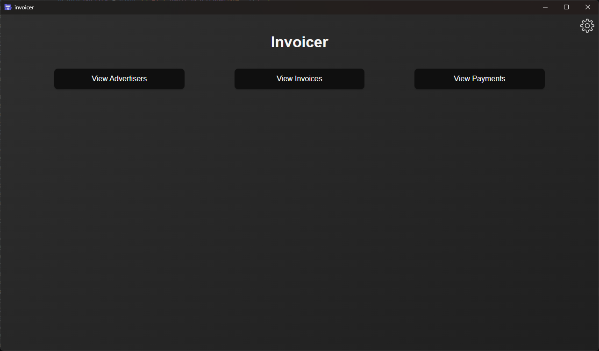
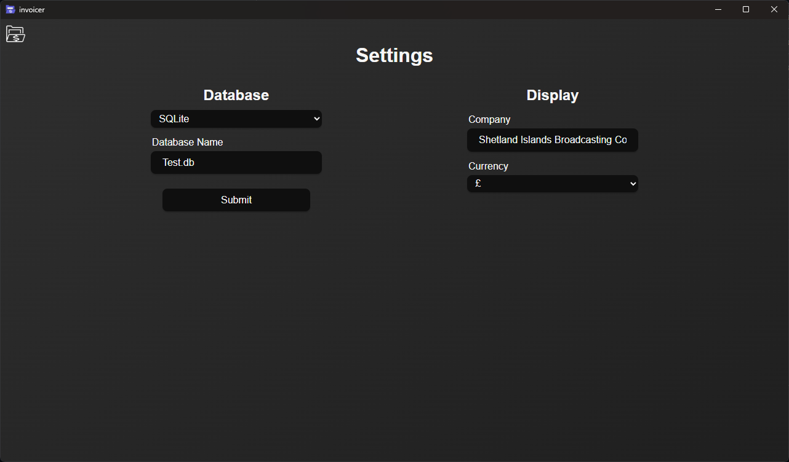
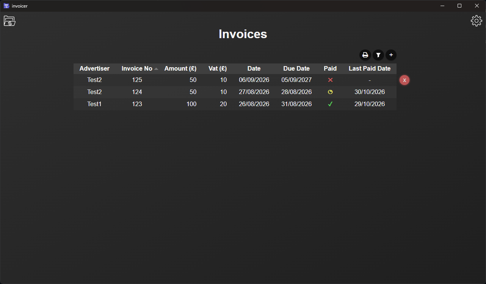
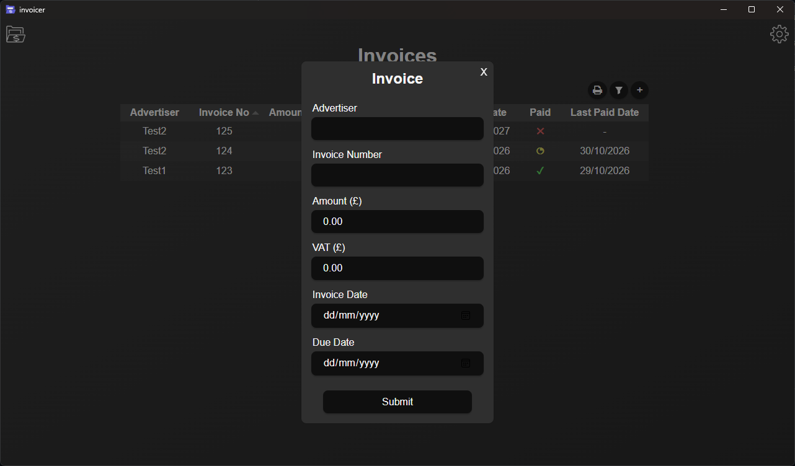
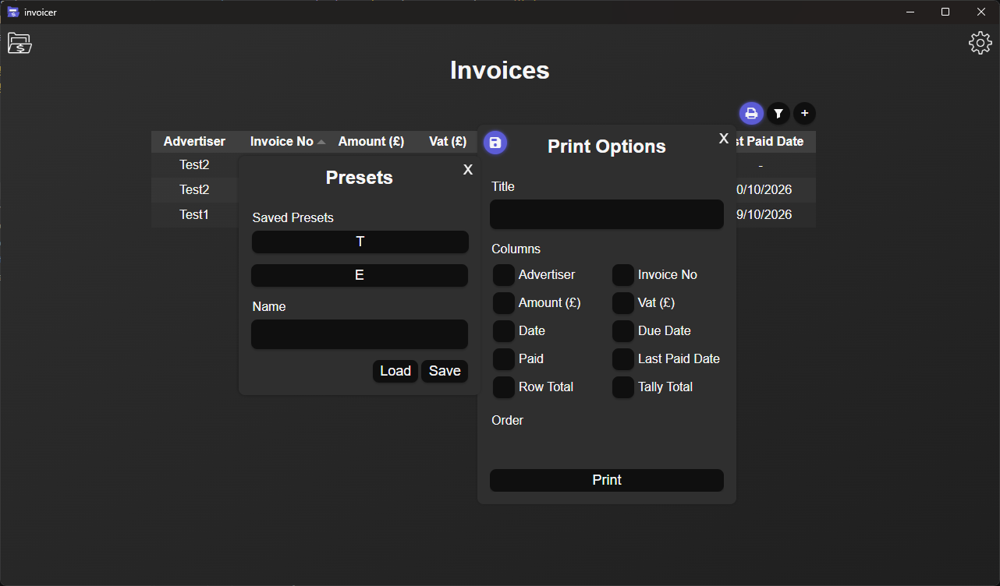
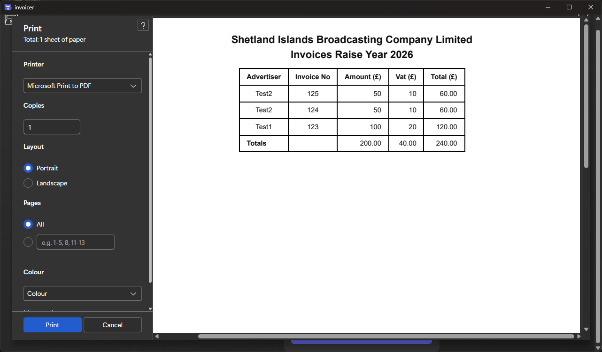
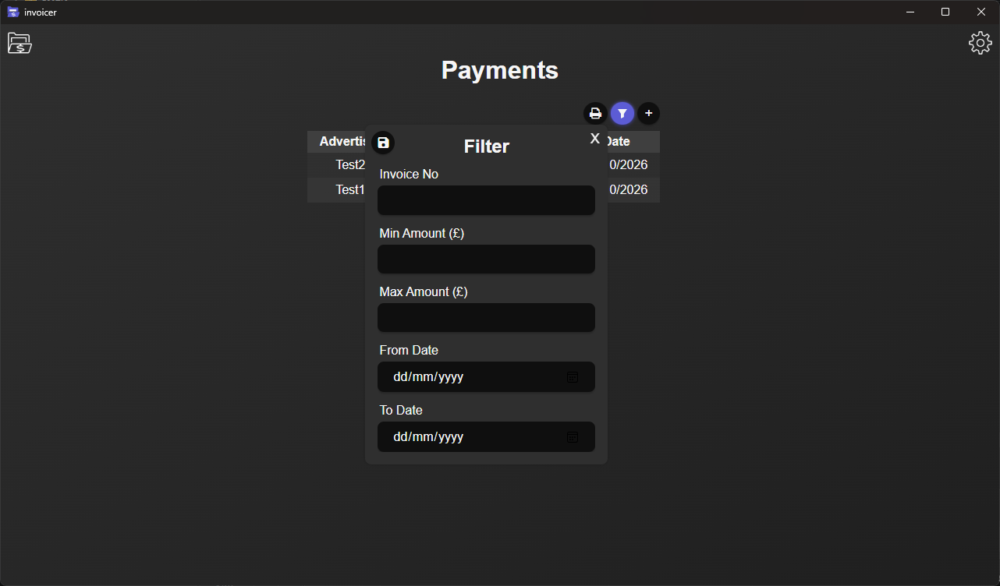

# Invoicer
A way to store, display and print all of your invoices. 

# How It Works
1. Enter/create the database you want to store to.
2. Enter the customers and invoices.
3. View the tables and information it displays.
4. (Optional) Print the tables you want.

